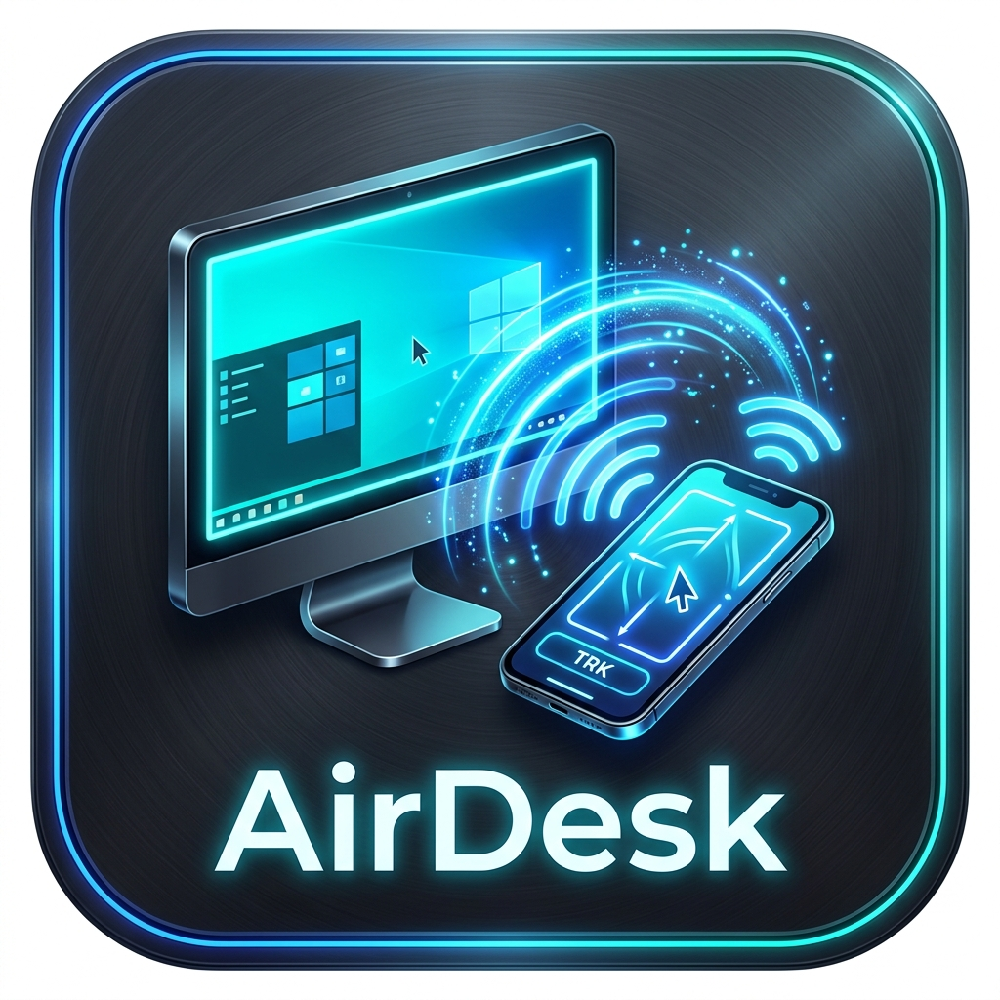
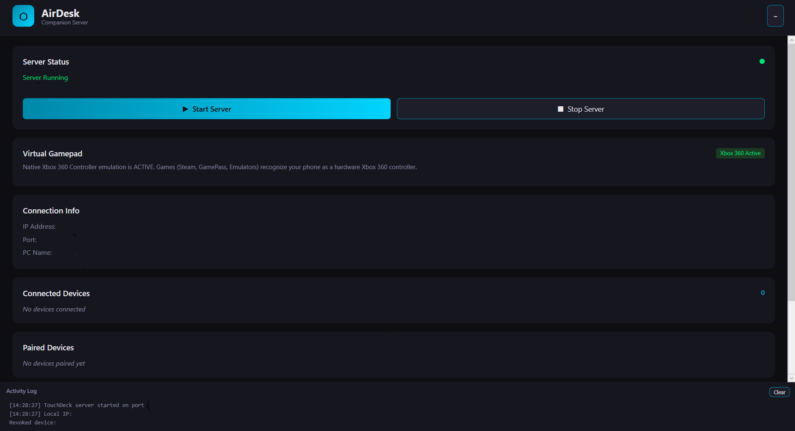

<p align="center">
  
</p>

<h1 align="center">AirDesk</h1>
<p align="center">
  <strong>Control your PC using your mobile phone. Turn your Android into an ultra-low-latency wireless touchpad, mouse, keyboard, game controller, and media remote for Windows 10 & 11.</strong>
</p>

<p align="center">
  <a href="https://yashwanthvm06.github.io/AirDesk/">🌐 <strong>Live Website</strong></a> •
  <a href="#-quick-install-guide-for-everyone">Quick Install</a> •
  <a href="#-screenshots--demo">Screenshots</a> •
  <a href="#features">Features</a> •
  <a href="#-build-from-source-developers">Build from Source</a> •
  <a href="#security-architecture">Security</a> •
  <a href="#contributing">Contributing</a> •
  <a href="#license">License</a>
</p>

<p align="center">
  
  
  
  
  
</p>

<!-- ========================================== -->
<!-- ONE-CLICK DOWNLOAD BUTTONS FOR USERS       -->
<!-- ========================================== -->
<p align="center">
  <a href="https://github.com/yashwanthvm06/AirDesk/releases/latest">
    
  </a>
  &nbsp;&nbsp;&nbsp;&nbsp;
  <a href="https://github.com/yashwanthvm06/AirDesk/releases/latest">
    
  </a>
</p>

<p align="center">
  <sub>No coding or setup required! Just download the files above and follow the 3-step guide below.</sub>
</p>

---

## 📸 Screenshots & Demo

| Windows Companion UI | Precision Trackpad | Virtual Gamepad |
| :---: | :---: | :---: |
|  |  |  |


---

## 🚀 Quick Install Guide (For Everyone)

**You do NOT need any programming or tech experience.** Follow these 3 simple steps:

### Step 1: On Your Windows PC
1. Click the blue **[Download for Windows](https://github.com/yashwanthvm06/AirDesk/releases/latest)** button above.
2. Double-click `AirDeskCompanion.exe` to run it (no installation or setup wizard needed!).
3. If Windows asks for network permission, click **"Allow Access"**.
4. The window will open showing your PC's **IP Address** and a **6-Digit PIN**.

### Step 2: On Your Android Phone
1. Click the green **[Download for Android](https://github.com/yashwanthvm06/AirDesk/releases/latest)** button above on your phone (or transfer the `.apk` file to your phone).
2. Tap the file to install it. If Android says *"Install unknown apps"*, tap **Settings** and flip the switch to allow.
3. Open the **AirDesk** app.

### Step 3: Connect & Enjoy!
1. Make sure your phone and PC are connected to the **same Wi-Fi network**.
2. On your phone, tap **Pair PC** and enter the **IP address** shown on your PC screen.
3. Enter the **6-digit PIN** shown on your PC screen.
4. **Done!** Your phone is now a wireless trackpad, keyboard, and gamepad. Next time, it reconnects automatically with 1 tap.

---

### 🎮 For PC Gamers: Genuine Xbox 360 Controller Setup (Optional)

If you play controller-only PC games (like **FIFA, Forza Horizon, Rocket League, GTA, or Steam / Game Pass** titles), Windows expects an official Xbox controller.

AirDesk can create a **genuine virtual Xbox 360 controller** on Windows in seconds:

1. **[👉 Click here to directly download ViGEmBus Installer](https://github.com/nefarius/ViGEmBus/releases/download/v1.22.0/ViGEmBus_Setup_1.22.0.exe)** *(official direct download link)*.
2. Double-click the downloaded file (`ViGEmBus_Setup_1.22.0.exe`) and click **Next → Install** (takes 10 seconds).
3. Open or restart `AirDeskCompanion.exe`.
4. **Done!** Your PC will now detect your phone as a genuine physical Xbox 360 Controller with dual analog sticks, analog triggers, and haptic rumble!

> 💡 *If you skip this, AirDesk still works great by automatically mapping your gamepad to PC keyboard controls (WASD, Space, Shift).*

#### 🙏 Special Thanks & Credits
Virtual Xbox 360 gamepad hardware emulation is powered by **ViGEmBus**, an incredible open-source driver created by **[Benjamin Höglinger-Stelzer (Nefarius)](https://github.com/nefarius)** and the **[ViGEm Project](https://github.com/nefarius/ViGEmBus)**. We are immensely grateful to Nefarius for making high-performance controller emulation available to the entire open-source community!

---

## ⚡ Why AirDesk? (Comparison with Other Apps)

| Feature | 🚀 AirDesk | 📱 Unified Remote | 🎮 PC Remote / Monect |
|---|:---:|:---:|:---:|
| **Price** | **100% Free Forever** | Freemium ($4.99+ for full) | Freemium / Paid |
| **Advertisements** | **🚫 Zero Ads** | Ads in free version | Heavy banner & video ads |
| **Cloud / Telemetry** | **🚫 100% Offline LAN** | Internet account sync | Cloud accounts required |
| **Input Security** | **🔒 6-Digit PIN + HMAC-SHA256** | Password / None | Basic / None |
| **Latency** | **⚡ Sub-5ms (Asynchronous WebSockets)** | 15–30ms | 10–25ms |
| **UI Framework** | **Modern Jetpack Compose + .NET 10** | Legacy UI | Heavy custom UI |
| **License** | **Open Non-Commercial (CC BY-NC 4.0)** | Closed Source | Closed Source |

---

## 🎮 Key Features

| Category | Highlights |
|---|---|
| **Precision Trackpad** | Multi-touch cursor, smooth 2-finger scroll, tap-to-click, double-tap, right-click long-press |
| **Full PC Keyboard** | All modifier keys (`Ctrl`, `Alt`, `Shift`, `Win`, `Esc`, `Tab`), function row `F1`–`F12`, arrow keys, and a direct-typing field that sends full Unicode sentences |
| **Virtual Gamepad** | Console-style analog joystick, ABXY face buttons, LB/RB bumpers, LT/RT analog triggers, D-Pad |
| **Media & Presentation Remote** | Play/Pause, Skip, Volume, Mute · Next/Prev Slide, F5 Slideshow, Black Screen |
| **Haptic Feedback** | Custom waveform vibration patterns for mouse clicks, keystrokes, gamepad actions, and connection events |
| **Zero-Friction Pairing** | 6-digit PIN displayed on-screen → HMAC-SHA256 challenge-response tokens → instant 1-tap reconnect |
| **Ultra-Low Latency** | Async WebSocket streaming designed for sub-5 ms input lag over local 5 GHz Wi-Fi |

---

## Repository Structure

```
AirDesk/
├── android-app/                   # Android Client (Kotlin + Jetpack Compose)
├── windows-companion/             # Windows Companion (.NET 10 / C# / WPF)
├── screenshots/                   # Demo images & preview assets
├── protocol/                      # Wire protocol spec (WebSocket / JSON)
├── docs/                          # Architecture, privacy & security guides
└── tests/                         # Automated Python diagnostic suite
```

---

## 🛠️ Build from Source (Developers)

### Android Client

```powershell
cd android-app

# Debug build
./gradlew assembleDebug

# Signed release build (requires keystore — see "Release Signing" below)
./gradlew assembleRelease
```

### Windows Companion

```powershell
cd windows-companion

# Debug run
dotnet run

# Self-contained release build
dotnet publish -c Release -r win-x64 --self-contained true -o ../release-builds/windows
```

### Release Signing (Android)

The build script reads signing credentials from **environment variables** or a local `keystore.properties` file (never hard-coded):

1. Generate a keystore (if you don't have one):
   ```bash
   keytool -genkeypair -v -keystore release-keystore.jks \
     -alias AirDesk -keyalg RSA -keysize 2048 -validity 10000
   ```
2. Place `release-keystore.jks` in `android-app/`.
3. Create `android-app/keystore.properties`:
   ```properties
   KEYSTORE_PASSWORD=your_store_password
   KEY_ALIAS=AirDesk
   KEY_PASSWORD=your_key_password
   ```

> **⚠️ Never commit `release-keystore.jks` or `keystore.properties`.** Both are in `.gitignore`.

Alternatively, set environment variables `KEYSTORE_PASSWORD`, `KEY_ALIAS`, and `KEY_PASSWORD` for CI pipelines.

---

## Security Architecture

AirDesk operates **exclusively over your local Wi-Fi/LAN** — no cloud, no internet traffic, no analytics.

### Pairing & Authentication

| Step | Description |
|---|---|
| **PIN Challenge** | A cryptographically random 6-digit PIN is generated on the PC and displayed *only on screen*. The Android app sends a blank challenge to prevent the PIN from traveling over the network. |
| **Token Issuance** | On correct PIN entry, the server issues a 256-bit random session token. |
| **HMAC Challenge-Response** | Returning devices authenticate via HMAC-SHA256: the server sends a single-use nonce, the client signs it with its stored token, and the server verifies using constant-time comparison (`FixedTimeEquals`). The nonce is invalidated immediately after first use — replays are rejected. |
| **Brute-Force Protection** | Max 5 failed PIN attempts per device → 60-second lockout. Global rate-limit: 10 pairing requests/minute. Repeated requests from the same device reuse the existing PIN (prevents PIN-reset spam). |

### Token Storage

| Platform | Mechanism |
|---|---|
| **Android** | `EncryptedSharedPreferences` (AES-256-GCM, backed by hardware Android Keystore). If the Keystore is unavailable, tokens stay in-memory only — **no plaintext fallback**. |
| **Windows** | Windows DPAPI (`ProtectedData.Protect`). If decryption fails, the data is treated as corrupted (no plaintext fallback). |

### Connection Security

- **Transport**: WebSocket over TCP (`ws://`). See [Known Limitations](#known-limitations).
- **Cleartext policy**: Android `network_security_config.xml` denies cleartext globally; permits it only for private LAN ranges (`10.x`, `192.168.x`, `172.16.x`, `localhost`).
- **Connection limits**: Max 5 authenticated + 10 unauthenticated connections. Handshake timeout: 15 s. Auth timeout: 30 s.
- **Input validation**: Mouse deltas, scroll values, and stick positions are clamped. Non-finite values are rejected. Oversized messages (> 4 KB) are dropped.
- **Per-session tracking**: Disconnecting one client releases only *that* client's held keys/buttons.
- **Device revocation**: "Forget device" on the Companion immediately drops the active session and erases the stored token.

---

## Automated Test Suite

Test the Windows Companion without a physical phone:

```powershell
cd tests
pip install websockets
python test_companion_client.py 127.0.0.1 9876
```

The script performs:
- WebSocket handshake
- 6-digit PIN pairing flow
- Ping/Pong latency benchmark (< 1 ms on localhost)
- Mouse movement & button test
- Controller button test

---

## Known Limitations

| Area | Detail |
|---|---|
| **Unencrypted transport** | WebSocket traffic uses `ws://`, not `wss://`. On a trusted home LAN this is acceptable, but on shared or public Wi-Fi an eavesdropper on the same network could observe input traffic. The initial pairing token exchange is protected by the HMAC challenge-response (the raw token is never re-sent after pairing), but adding TLS (`wss://`) is planned for a future release. |
| **Local network only** | AirDesk is designed for same-LAN use. It does not support NAT traversal, cloud relay, or internet-based connections. |
| **Windows only (companion)** | The companion app currently targets Windows 10/11 with .NET 10. macOS and Linux are not yet supported. |
| **No vGamepad driver** | Gamepad inputs are translated to keyboard shortcuts, not a virtual Xbox/XInput device. Some games may not recognize them as controller input. |
| **Legacy token auth** | A backward-compatible plain-token `auth` path exists for older clients. It will be removed in protocol v2. |

---

## Contributing

Contributions are welcome! Please see [CONTRIBUTING.md](CONTRIBUTING.md) for guidelines.

**Quick checklist:**
1. Fork the repo and create a feature branch.
2. Follow existing code style and naming conventions.
3. Test your changes against the automated test suite.
4. Submit a pull request with a clear description.

---

## Documentation

- [Wire Protocol Specification](protocol/PROTOCOL.md)
- [Architecture & Technical Deep-Dive](docs/ARCHITECTURE.md)
- [Privacy Policy](docs/PRIVACY_POLICY.md)
- [Release Checklist](docs/RELEASE_CHECKLIST.md)

---

## License

This project is licensed under the **Creative Commons Attribution-NonCommercial 4.0 International (CC BY-NC 4.0)** license.

- ✅ **Free to use:** Anyone can download, run, and use this project for free.
- ✅ **Free to modify:** Anyone can remix, adapt, and build upon this code.
- ❌ **No commercial use:** **NO ONE is permitted to sell, resell, or monetize** this software, its code, or derivative versions.
- ℹ️ See the full [LICENSE](LICENSE) file for complete terms.

---

<p align="center">
  <sub>Made with ❤️ by the AirDesk team</sub>
</p>


